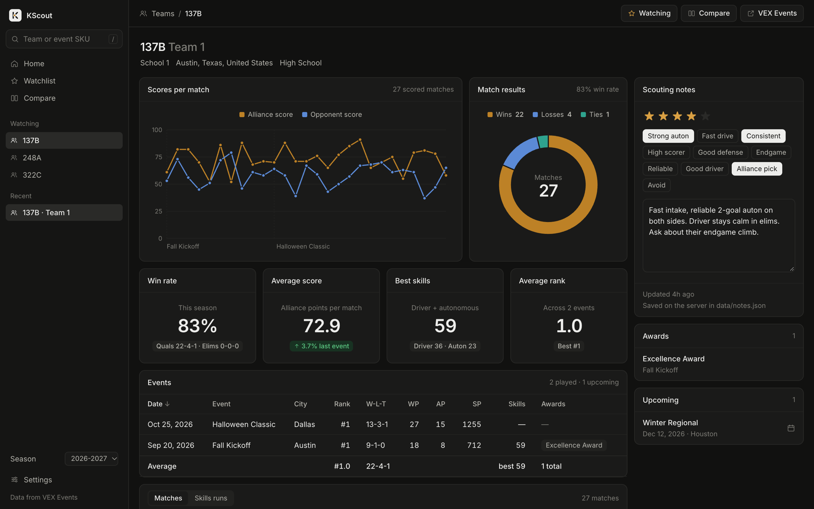
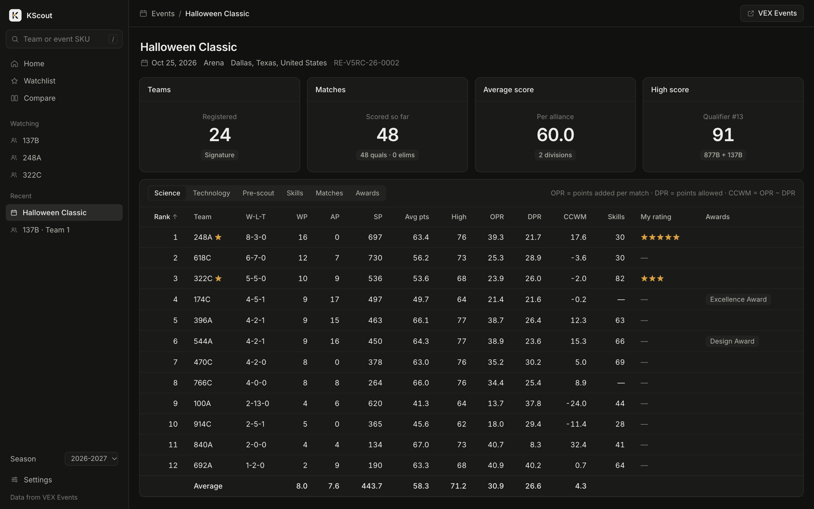

# KScout

A scouting dashboard for the **VEX V5 Robotics Competition (V5RC)**. Look up any team or event and see season records, rankings, skills, awards and match history, with stats like OPR, DPR and CCWM worked out for you. Keep scouting notes, ratings and tags for the teams you care about.

Data comes from the official [VEX Events API](https://events.vex.com/api/v2) (formerly RobotEvents). No database, no build step, no dependencies: just Node.





<sub>Screenshots use made-up teams and events.</sub>

## Features

- **Team page:** overall, qualification and elimination records; win rate; average and high score; best driver, autonomous and combined skills; average and best event rank; a score-per-match chart; a win/loss/tie breakdown; and tables of events, matches and skills runs.
- **Event page:** rankings for each division with computed **OPR / DPR / CCWM**, skills standings, match results and awards.
- **Pre-scout:** season stats for every team registered at an upcoming event in one sortable table, so you can scout before it starts.
- **Compare:** up to 6 teams side by side, with the best value in each row highlighted.
- **KScout rating:** one 0–100 number per team, with the breakdown behind it. See it on team pages, in Compare and Pre-scout, or rank any event or list of teams on the **Rankings** page.
- **Watchlist and notes:** star teams, rate them 1–5, tag them (strong auton, good defense, alliance pick…) and write notes. Export to CSV, or back up and restore as JSON.
- **Season picker** for past seasons, **light and dark mode**, and a layout that works on phones.

## Quick start (on your computer)

You need [Node.js](https://nodejs.org) 18 or newer and a VEX Events API token.

```bash
git clone https://github.com/was-taken/kscout.git
cd kscout
npm start
```

Open http://localhost:5173. The first time, the app asks for your token:

1. Sign in, or create an account, at [events.vex.com](https://events.vex.com).
2. Open the [API page](https://events.vex.com/api/v2) and click **Request Access**. Approval can take a while.
3. Once approved, create an access token and paste it into the app. It's saved to `.env` on your computer only.

When run this way, KScout only accepts connections from your own computer, and notes are saved to `data/notes.json`.

## Hosting it as a website

KScout needs a host that runs Node (Render, Railway, Fly.io and similar), not a static-page host.

**On Render:** create a new **Blueprint** from your fork of this repository. It reads [`render.yaml`](render.yaml) and asks for your token and team password.

**Anywhere else:** create a web service with the start command `npm start` and set the environment variables below. See [`.env.example`](.env.example) for the full list.

| Variable | Value | What it does |
|---|---|---|
| `PUBLIC_SITE` | `1` | Turns on hosted mode: accepts outside connections, turns off the in-app token form, and protects notes. |
| `ROBOTEVENTS_TOKEN` | your VEX Events token | Used by the server only. Visitors never see it and can't change it. |
| `TEAM_PASSWORD` | 10+ characters | Optional. Turns on shared team notes that only people with the password can read or edit. Without it, each visitor's notes stay in their own browser. |
| `DATA_DIR` | a folder on a persistent disk, e.g. `/var/data` | Where shared team notes are saved. Without a persistent disk, most hosts erase saved files on every restart or deploy. |

The host sets `PORT` itself. A health check is at `/healthz`.

### How notes work on a hosted site

- **With `TEAM_PASSWORD`:** teammates open **Settings → Team sign-in** and enter the password once per browser (it lasts 30 days). Notes written before signing in are added to the team's notes. Change the password to sign everyone out.
- **Without it:** notes are saved only in each visitor's browser. Nobody else can see or change them.
- **Either way:** use **Settings → Download backup** now and then. **Restore backup** merges a backup back in, keeping the newer version of each note.

### Security

- Password guessing is limited to 5 tries per minute per visitor. Sign-in uses a signed, HttpOnly, SameSite cookie.
- Notes can't be written from other websites, and incoming notes are checked and trimmed before saving.
- Each visitor is limited to 600 API requests a minute (`API_REQS_PER_MIN`). Responses are cached for 15 minutes (`CACHE_MINUTES`), and identical requests share one call to VEX Events.
- Security headers are sent: `nosniff`, no framing, same-origin referrer, and HSTS over HTTPS.

**Before hosting publicly:** every visitor's lookups use *your* API token. Check the terms you agreed to when requesting API access. To keep it to your own team, set `TEAM_PASSWORD` and don't share the link widely.

## How the stats are calculated

- **Win rate** counts a tie as half a win. Practice matches are left out.
- **OPR** (offensive power rating) estimates how many points a team adds to its alliance each qualification match, using a least-squares fit over every qualification match at the event. **DPR** does the same for points allowed, and **CCWM** is OPR − DPR. These only become reliable after several matches.
- **Best skills** is the best driver + autonomous total from a single event.

### KScout rating

A 0–100 estimate of how strong a team has been this season: **60% match results and 40% Robot Skills**. A team needs at least one finished event with qualification matches. The formula and its tunable numbers are in [`public/rating.js`](public/rating.js).

**1. Percentile at each event.** Three measures, each the share of the team's division it beat (ties count half):

| Measure | Weight | From |
|---|---|---|
| Match contribution | 45% | CCWM over qualification matches, which separates a team from its partners. Needs at least 3 matches. |
| Playoff run | 30% | Furthest elimination round reached, with the champions above the finalists. |
| Qualifying finish | 25% | Qualification rank. |

`P = Σ(weight × measure) / Σ(weight)`, over the measures that have data at that event.

**2. Event score.** `S = low + (high − low) × P`, using the range for the event's level:

| Level | Range |
|---|---|
| World Championship | 40–100 |
| Signature, National | 25–95 |
| State, Regional | 15–90 |
| Other tournaments | 0–85 |

**3. Results score.** `Results = (42.5 + Σ wᵢSᵢ) / (1 + Σ wᵢ)`, where `wᵢ = 0.85^(events since) × min(1, division teams / 24)`. The 42.5 and 1 act as one average event in every team's history, so one good day can't top the list.

**4. Rating.** `Rating = 0.6 × Results + 0.4 × 100 × min(1, best skills / season top)`. Best skills is the team's highest driver + autonomous total from one event. Season top is the highest total at any finished Signature event or Worlds that season. Until one has finished, the rating is the results score alone.

Divisions under 4 teams and events still in progress are skipped. Confidence is Low for 1 counted event, Medium for 2–3 and High for 4 or more.

The rating covers groups you choose because VEX Events has no single request for every team's season. It reflects results only, and is an estimate rather than a measure of true strength.

## Project layout

```
server.js           Node server: static files, VEX Events proxy and cache, notes, sign-in
public/index.html   Page shell (sidebar, top bar)
public/app.js       Pages, tables, charts
public/data.js      API calls, notes storage, stat calculations
public/rating.js    KScout rating formula
public/style.css    Styles and light/dark themes
render.yaml         One-click Render setup
```

Run `npm run check` to syntax-check everything. GitHub Actions runs it, plus a start-up test, on every push.

## License

[MIT](LICENSE). KScout is an independent project. It is not affiliated with or endorsed by VEX Robotics, Innovation First, or the Robotics Education & Competition Foundation. VEX and V5 are their trademarks.
